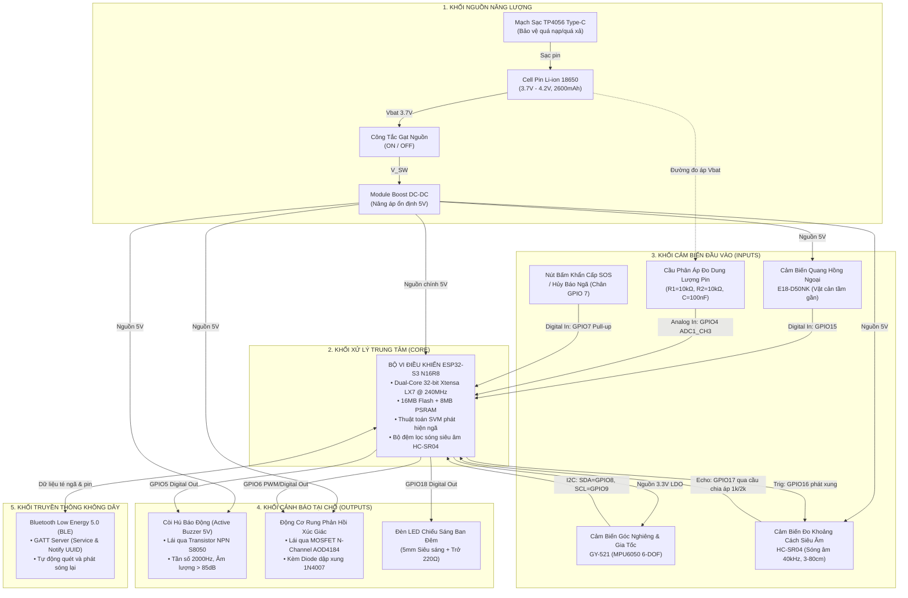
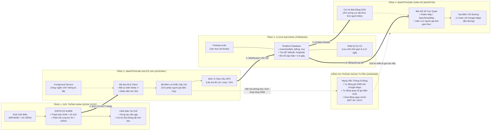

# TỔNG HỢP SƠ ĐỒ KHỐI HỆ THỐNG GẬY THÔNG MINH (SMART CANE IoT)
## DỰ ÁN: GẬY THÔNG MINH HỖ TRỢ NGƯỜI CAO TUỔI & KHIẾM THỊ
> **Tài liệu phục vụ Báo cáo Khóa luận Tốt nghiệp & Slide thuyết trình Hội đồng**

---

## 1. SƠ ĐỒ KHỐI PHẦN CỨNG GẬY (HARDWARE NODE BLOCK DIAGRAM)

Sơ đồ thể hiện luồng tín hiệu và luồng năng lượng giữa Vi điều khiển trung tâm ESP32-S3 với các khối ngoại vi trên bo mạch gậy:

---

## 2. SƠ ĐỒ KHỐI TOÀN HỆ THỐNG IoT ĐA TẦNG (END-TO-END SYSTEM)

Sơ đồ thể hiện chu trình dữ liệu hoàn chỉnh từ lúc người già té ngã/gặp vật cản trên đường cho đến khi thông tin cứu nạn truyền tới người thân:

---

## 3. BẢNG GIẢI THÍCH CHỨC NĂNG TỪNG KHỐI (DÙNG ĐỂ THUYẾT TRÌNH)
